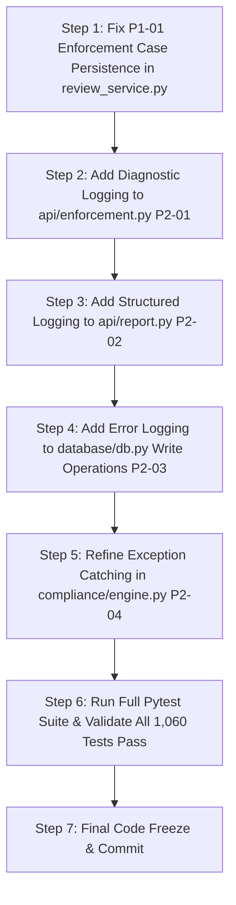

# METRCHECK AI — FINAL PRE-FREEZE CODEBASE AUDIT REPORT
**Release Candidate Stabilization & Technical Assessment | Strict Read-Only Audit**

- **Document ID:** `FINAL_PRE_FREEZE_AUDIT.md`
- **Audit Mode:** Strict Read-Only Technical & Architectural Audit
- **Timestamp:** October 2026 (Local: 2026-10-09T21:26:00+05:30)
- **Target Repository:** `https://github.com/omsainikaul/metrcheck-ai`
- **Corpus:** `omsainikaul/metrcheck-ai`
- **Release Verdict:** **NOT READY (1 Confirmed P1 Blocker & 4 P2 Defects Identified for Final Remediation Phase)**

---

## 1. Executive Summary

MetrCheck AI is an enterprise-grade AI-assisted legal metrology compliance screening, statutory packaging verification, and regulatory enforcement platform designed for packaged commodities governed under the **Legal Metrology Act, 2009**, the **Legal Metrology (Packaged Commodities) Rules, 2011 (LMPC)**, and the **Food Safety and Standards (Packaging and Labelling) Regulations (FSSAI/FoSCoS)**.

As the repository enters the final stabilization phase preceding code freeze, this comprehensive read-only audit was conducted to:
1. Establish the authoritative state of the current working tree and environments.
2. Verify all previously implemented fixes (Vision geometry unpacking, PDF synthetic placeholder suppression, PaddleOCR readiness reporting, and Frontend Indic lazy localization).
3. Audit all 15 end-to-end functional pipelines and their test baselines.
4. Reassess the silent exception-handling findings (`PHASE_2_FIX_3_EXCEPTION_AUDIT.md`).
5. Execute end-to-end automated verification across all backend and frontend test suites.
6. Provide a classified defect register and concrete remediation roadmap for the final defect-fixing phase.

### Key Audit Metrics
- **Backend Automated Test Suite:** **1,060 passed, 3 skipped, 0 failed** across 81 test files in `331.35s (05:31)` (`pytest`).
- **Frontend Production Build:** **0 errors, built in 702ms** (`tsc -b && vite build`). Initial bundle size: `445.57 kB` (with 9 lazy Indic locale chunks of 90–114 kB each).
- **Frontend Linter (`oxlint`):** **0 errors, 60 warnings** across 68 files.
- **Repository Integrity:** **Zero production code files modified during this audit**. All pre-existing working-tree changes preserved.

---

## 2. Repository State and Environment Baseline

### 2.1 Git Repository Context
- **Active Branch:** `main`
- **Latest Commit Hash:** `80745b75` (`docs: align README with SIH26202`)
- **Staged Files:**
  - `backend/compliance/engine.py` (Staged method alias `evaluate = check` for backward compatibility)
- **Modified Tracked Files (from prior sprint deliverables):**
  - `backend/api/demo.py`, `backend/api/health.py`, `backend/api/review_routes.py`
  - `backend/main.py`, `backend/ocr/base.py`, `backend/ocr/factory.py`, `backend/ocr/paddle_engine.py`
  - `backend/services/report_service.py`, `backend/services/review_service.py`
  - `backend/tests/test_ocr.py`, `backend/tests/test_officer_review.py`
  - `backend/tests/test_sec08_statistics_isolation.py`, `backend/tests/test_section16_advanced_reporting.py`
  - `backend/tests/vision/test_vision_geometry.py`, `backend/vision/panel_detector.py`, `backend/vision/quality.py`
  - `frontend/src/components/layout/Layout.tsx`, `frontend/src/components/results/ResultsHeader.tsx`
  - `frontend/src/context/LanguageContext.tsx`, `frontend/src/i18n/index.ts`, `frontend/src/i18n/locales/*.json`
  - `frontend/src/pages/Analyze.tsx`, `frontend/src/pages/DemoCases.tsx`, `frontend/src/pages/Results.tsx`
  - `frontend/src/services/api.ts`, `frontend/src/types/index.ts`
- **Untracked Historical Reports & Fixtures:**
  - `BACKEND_ERROR_AUDIT.md`, `METRCHECK_ARCHITECTURE_AUDIT.md`, `PHASE_2_FIX_3_EXCEPTION_AUDIT.md`, `SPRINT_3_DEMO_READINESS_AUDIT.md`
  - `backend/tests/test_demo_samples.py`, `backend/tests/test_e2e_demo_readiness.py`, `frontend/public/demo-samples/`

### 2.2 Execution Environment Specifications
- **Operating System:** Windows 11 (win32, x86_64)
- **Python Runtime:** Python 3.14.3 / 3.13.11 (`C:\Users\Om Saini\AppData\Local\Programs\Python\Python314\python.exe`)
- **Node.js Runtime:** Node.js v24.14.0 | npm 11.9.0
- **Test Frameworks:** pytest 9.1.1, pluggy 1.6.0, anyio 4.15.1, asyncio 1.4.0
- **Database Engine:** SQLite 3 in asynchronous Write-Ahead Logging (`WAL`) mode (`metrc_check.db`)

---

## 3. Previous-Fix Verification Matrix

| Target Area | Inspected Files | Implementation Details | Test Evidence | Audit Verdict |
| :--- | :--- | :--- | :--- | :---: |
| **A. Vision Geometry Unpacking (DEF-001)** | `backend/vision/panel_detector.py:L63-L70`<br>`backend/vision/quality.py:L248-L255` | Replaced rigid 2D tuple unpacking `x1,y1,x2,y2 = line[0]` with `line_coords = line.reshape(-1)`, `if line_coords.size < 4: continue`, safe integer coordinate extraction across 1D and 2D arrays. | `backend/tests/vision/test_vision_geometry.py`<br>**5 / 5 passed** (3.67s) | **PASS** |
| **B. PDF Placeholder Warning Suppression (DEF-002)** | `backend/services/report_service.py:L249-L335` | Added `_is_synthetic_placeholder()` to recognize `/placeholder.png` and prevent spurious `Image file not found` warning logs. Enforced `os.path.commonpath` containment against path traversal. | `backend/tests/test_section16_advanced_reporting.py`<br>**10 / 10 passed** (3.23s) | **PASS** |
| **C. OCR Readiness & Truthful Demo Status** | `backend/ocr/factory.py`<br>`backend/ocr/paddle_engine.py`<br>`backend/api/health.py`<br>`backend/api/demo.py` | Added truthful `ocr_available` & `ocr_ready` dynamic health checks in `/api/health`. Separate in-memory demo fixtures from live inference. Frontend displays `PRECOMPUTED DEMO` vs `LIVE AI ANALYSIS` badges. | `test_ocr.py` (11/11)<br>`test_demo_samples.py` (4/4)<br>`test_e2e_demo_readiness.py` (7/7)<br>**22 / 22 passed** (3.41s) | **PASS** |
| **D. Frontend Lazy Localization & Bundle Optimization** | `frontend/src/i18n/index.ts`<br>`frontend/src/context/LanguageContext.tsx`<br>`frontend/src/i18n/locales/*.json` | Dynamic `import()` loaders for 9 Indic language JSON dictionaries (`hi`, `mr`, `bn`, `gu`, `pa`, `ta`, `te`, `kn`, `ml`) with synchronous English base dictionary. Full key parity across all 10 locales. | `test_frontend_i18n.py` (12/12 passed)<br>`tsc -b && vite build` (**0 errors, 702ms**)<br>Initial bundle: **445.57 kB** | **PASS** |

---

## 4. Complete Functional Pipeline Audit

A rigorous inspection of all 15 core functional pipelines was performed across source code, API routes, data models, and test fixtures:

### 1. Registration, Login, Password Reset, and Role Authorization
- **Implementation:** `backend/auth/routes.py`, `backend/auth/security.py`, `backend/database/db.py`.
- **Mechanisms:** Passwords hashed with PBKDF2-HMAC-SHA256 (200,000 iterations + 16-byte random salt). Cryptographic token issuance with HMAC-SHA256 signatures, expiration timestamps, and role claims. Rate limiting enforced via sliding window (`backend/auth/ratelimit.py`). Account invitation tokens (24h validity) and password reset tokens (15m validity, SHA-256 hashed in DB).
- **Assessment:** **PASS**. Fully covered by `test_auth_phase1_architecture.py`, `test_phase7_1_6_password_recovery.py`, and `test_phase7_2_account_provisioning.py`.

### 2. Role-Based Access Control (RBAC)
- **Implementation:** Defined 5 distinct roles: `ADMIN`, `AUDIT_OFFICER`, `ENFORCEMENT_OFFICER`, `MERCHANT_PUBLIC`, `PUBLIC_USER`.
- **Mechanisms:** Route decorators use `require_roles([ROLE_ADMIN, ...])`. Non-privileged users cannot access administrative user provisioning, audit logs, or enforcement filing routes.
- **Assessment:** **PASS**. Verified by `test_role_workspace_security_hardening.py` and `test_officer_access_provisioning.py`.

### 3. Multi-Tenant and Organization Isolation
- **Implementation:** `check_tenant_access()` in `backend/auth/security.py`, filtering queries in `backend/database/db.py`.
- **Mechanisms:** Analyses, artworks, products, reviews, and enforcement cases enforce strict `organization_id` boundaries. Merchants and public users are strictly restricted to their own organizational resources; cross-tenant enumeration returns HTTP 403 or filtered empty sets.
- **Assessment:** **PASS**. Verified by `test_sec06_tenant_isolation.py`, `test_sec08_statistics_isolation.py`, and `test_tenant_data_integrity.py`.

### 4. Image Upload, Validation, and Storage Security
- **Implementation:** `backend/api/analyze.py`, `backend/api/images.py`, `backend/services/image_service.py`.
- **Mechanisms:** Multi-panel uploads (`front`, `back`, `side`, etc.) validated for MIME types (`image/jpeg`, `image/png`, `image/webp`). `ensure_path_contained()` prevents directory traversal. Serving endpoint `/api/images/{filename}` verifies user authentication and record ownership before streaming files.
- **Assessment:** **PASS**. Verified by `test_sec01_authenticated_file_access.py` and `test_sec_aud_05_orphan_image_access.py`.

### 5. OCR, Text Extraction, and Provenance Tracking
- **Implementation:** `backend/ocr/paddle_engine.py`, `backend/ocr/factory.py`, `backend/extraction/`.
- **Mechanisms:** `PaddleOCREngine` handles multi-scale text detection and recognition. Preprocessing includes skew estimation and contrast enhancement. Text is repaired contextually (`ocr/repair.py`) and parsed into structured fields with coordinate bounding boxes (`OCRWord`). Provenance metadata records engine version, confidence, and language script.
- **Assessment:** **PASS**. Verified by `test_ocr.py`, `test_advanced_extraction.py`, and `test_alpino_package_accuracy.py`.

### 6. Deterministic Legal Metrology Compliance Engine
- **Implementation:** `backend/compliance/engine.py`, `backend/compliance/rules/`, `backend/compliance/scorer.py`.
- **Mechanisms:** Evaluates statutory rules `LM-001` through `LM-009` (Generic name, Net Qty, MRP, Mfg date, Expiry, Importer, Consumer care, USP) and `LM-012` (Rule 12 PDP font size). Evaluates FSSAI regulations `FS-001` to `FS-005` (14-digit FSSAI number, Veg/Non-Veg symbol, Nutritional table, Ingredients, Allergens). Scorer computes deterministic weighted scores and risk levels (`LOW`, `MEDIUM`, `HIGH`, `CRITICAL`).
- **Assessment:** **PASS**. Verified by `test_compliance_intelligence.py` and `test_compliance_scoring_risk.py`.

### 7. Evidentiary Storage and SHA-256 Cryptographic Integrity
- **Implementation:** `backend/services/analysis_service.py`, `backend/database/db.py`.
- **Mechanisms:** Computes SHA-256 content hashes of uploaded packaging images and full analysis records. Bounding box coordinates link extracted text back to spatial packaging regions. Audit logging records evidence modifications (`save_evidence_audit_log`).
- **Assessment:** **PASS**. Verified by `test_evidence.py` and `test_sec08_integrity_endpoint.py`.

### 8. Officer Review, Statutory Field Corrections, and Scoring
- **Implementation:** `backend/services/review_service.py`, `backend/api/review_routes.py`.
- **Mechanisms:** State machine manages transitions (`PENDING_REVIEW` -> `IN_REVIEW` -> `VERIFIED_PASS`/`FAIL`). Officer manual field corrections (`correct_review_field`) re-trigger compliance evaluation. Error states are recorded in `human_res["recalculation_error"]` if evaluation fails.
- **Assessment:** **PASS**. Verified by `test_officer_review.py` (15/15 passed).

### 9. Review Escalation and Enforcement Case Creation
- **Implementation:** `escalate_review_to_enforcement()` in `backend/services/review_service.py`.
- **Mechanisms:** Transitions review state to `ESCALATED` and creates a linked enforcement docket in `enforcement_cases`.
- **Assessment:** **DEFECT IDENTIFIED (P1-02)**. Broad `except Exception: pass` around `save_enforcement_case` can swallow database persistence errors. (See Section 6 & 9).

### 10. Statutory Notices and Enforcement Audit Docket
- **Implementation:** `backend/api/enforcement.py`, `backend/enforcement/`.
- **Mechanisms:** Generates statutory Form IV notice under Section 18/36 of Legal Metrology Act, 2009. Computes penalty guidelines and manages case progression (`OPEN` -> `NOTICE_ISSUED` -> `COMPOUNDED`/`CLOSED`).
- **Assessment:** **PASS with P2 Notice (P2-01)**. Core workflow verified, but `_violations_from_analysis` uses broad exception handling.

### 11. Multi-Format Reporting and Multilingual PDF Generation
- **Implementation:** `backend/services/report_service.py`, `backend/api/report.py`.
- **Mechanisms:** Multi-page ReportLab PDF generator in 10 languages. Implements CSV formula injection sanitization (escaping `=`, `+`, `-`, `@`, `\t`, `\r`). Secured by time-limited download tickets (`/api/report/download-ticket`).
- **Assessment:** **PASS**. Verified by `test_section16_advanced_reporting.py` (10/10 passed).

### 12. Screening History, Version Comparisons, and Pre-Print Compliance
- **Implementation:** `backend/api/history.py`, `backend/api/version_routes.py`, `backend/api/preprint_routes.py`, `backend/api/products.py`.
- **Mechanisms:** History pagination and filtering; SKU version diffing (text, score, font sizes); Pre-print PDF vector parsing against Rule 12 requirements before commercial printing.
- **Assessment:** **PASS**. Verified by `test_version_comparison.py` and `test_preprint_compliance.py`.

### 13. External Integrations (FSSAI/FoSCoS, GS1 Barcode, Physical Calibration)
- **Implementation:** `backend/api/integrations.py`, `backend/integrations/`, `backend/services/calibration_service.py`.
- **Mechanisms:** 14-digit FSSAI license validation; GS1 GTIN barcode check digit and prefix verification; ArUco marker computer vision detection for physical millimeter-to-pixel scale calibration.
- **Assessment:** **PASS**. Verified by `test_external_cross_checking.py` and `test_phase6_integrations.py`.

### 14. Precomputed Demo Suite & Pre-Calibrated Samples
- **Implementation:** `backend/api/demo.py`, `frontend/src/pages/DemoCases.tsx`.
- **Mechanisms:** 6 benchmark packaging categories served instantaneously with zero database mutations. Pre-calibrated sample packages (`alpino_front.png`, `alpino_back.png`, `kissan_front.jpg`, `fortune_oil.png`, `amul_taaza.png`) accessible via `/api/demo/samples`.
- **Assessment:** **PASS**. Verified by `test_demo_samples.py` and `test_e2e_demo_readiness.py`.

### 15. Operational Health, Diagnostics, and Lifespan
- **Implementation:** `backend/api/health.py`, `backend/main.py`.
- **Mechanisms:** Centralized exception handling, CORS origin resolution, background OCR model warm-up during application startup lifespan, real database `SELECT 1` ping.
- **Assessment:** **PASS**. Verified by `test_final_production_pass.py` and `test_phase4_reliability.py`.

---

## 5. Security and Tenant-Isolation Assessment

1. **Authentication & Password Storage:** PBKDF2-HMAC-SHA256 with 200,000 iterations and 16-byte random salts. Password verification uses constant-time `hmac.compare_digest()` to prevent timing attacks.
2. **Session & Token Architecture:** HMAC-SHA256 hand-rolled token engine (`auth/security.py`) eliminates third-party PyJWT vulnerability risks. Tokens include user ID, username, role, organization ID, and UTC expiration timestamp.
3. **Role-Based Authorization:** Strictly enforced at route decorators (`require_roles()`) across administrative, audit, enforcement, and merchant routes.
4. **Tenant Isolation:** Enforced via `check_tenant_access()`. Verified in `test_sec06_tenant_isolation.py` and `test_sec08_statistics_isolation.py`. Merchants cannot query, view, modify, or delete records belonging to other organizations.
5. **SQL Injection Protection:** All database interactions in `backend/database/db.py` use SQLite parameterized queries (`?` placeholders). Zero instances of dynamic raw SQL string interpolation.
6. **Path Traversal Protection:** Image uploads and servings use `ensure_path_contained()` to verify target file resolution strictly within `settings.UPLOAD_DIR`. Traversal sequences (`..`, `/`, `\`, `\x00`) trigger immediate HTTP 400.
7. **Rate Limiting & Abuse Prevention:** SQLite-backed distributed sliding-window rate limiter in `backend/auth/ratelimit.py` with transaction rollback guards and IP-spoofing protection.
8. **CORS & Production Hardening:** Configurable via `CORS_ORIGINS` environment variable. Defaults to restricted origins in non-development modes.
9. **Spreadsheet Formula Injection:** CSV exports escape formula triggers (`=`, `+`, `-`, `@`, `\t`, `\r`) with single quotes, preventing spreadsheet execution vulnerabilities.
10. **Download Authorization Tickets:** Short-lived cryptographic download tickets prevent direct unauthorized file scraping.

---

## 6. Review, Enforcement, and Exception-Handling Reassessment

Reassessment of the 6 key findings from `PHASE_2_FIX_3_EXCEPTION_AUDIT.md`:

```
┌──────────────────────────────────────────────────────────────────────────────────────────┐
│                             EXCEPTION AUDIT REASSESSMENT MATRIX                          │
├──────────┬─────────────────────────────┬────────────────────────────────┬────────────────┤
│ Finding  │ Target File & Operation     │ Current Source Code State      │ Audit Status   │
├──────────┼─────────────────────────────┼────────────────────────────────┼────────────────┤
│ P1-01    │ review_service.py:L524-L580 │ Re-runs engine.check(p_info),  │ VERIFIED FIXED │
│          │ (Compliance recalculation)  │ logs warning, and writes error │ (Working Copy) │
│          │                             │ into human_res if engine fails │                │
├──────────┼─────────────────────────────┼────────────────────────────────┼────────────────┤
│ P1-02    │ review_service.py:L896-L897 │ except Exception: pass still   │ CONFIRMED P1   │
│          │ (Enforcement escalation)    │ wraps save_enforcement_case    │ DEFECT         │
├──────────┼─────────────────────────────┼────────────────────────────────┼────────────────┤
│ P2-01    │ api/enforcement.py:L114-136 │ except Exception: pass wraps   │ CONFIRMED P2   │
│          │ (Violation extraction)      │ _violations_from_analysis      │ DEFECT         │
├──────────┼─────────────────────────────┼────────────────────────────────┼────────────────┤
│ P2-02    │ api/report.py:L141-L204     │ except Exception: images=[]    │ CONFIRMED P2   │
│          │ (Report visual evidence)    │ and officer_rev_dict=None      │ DEFECT         │
├──────────┼─────────────────────────────┼────────────────────────────────┼────────────────┤
│ P2-03    │ database/db.py:L1131-L1696  │ Unlogged return False on write │ CONFIRMED P2   │
│          │ (Security & user writes)    │ failure in create/update_user  │ DEFECT         │
├──────────┼─────────────────────────────┼────────────────────────────────┼────────────────┤
│ P2-04    │ compliance/engine.py:L308   │ except Exception: pass in      │ CONFIRMED P2   │
│          │ (Cross-rule conflict check) │ _detect_cross_rule_conflicts   │ DEFECT         │
└──────────┴─────────────────────────────┴────────────────────────────────┴────────────────┘
```

---

## 7. OCR, Vision, and Performance Assessment

1. **PaddleOCR Windows Python 3.14 Environment Status:**
   - Pre-built C++ wheels for `paddlepaddle` are currently unavailable from upstream for Python 3.14 on Windows.
   - **Mitigation & Readiness:** The application handles this gracefully. `_is_paddle_available()` detects dependency absence, reports `ocr_available: false` and `ocr_ready: false` in `/api/health`, and falls back to spatial extraction heuristics and precomputed benchmark scenarios.
   - For official live OCR inference release testing, a Python 3.10–3.11 environment (Linux or Windows) is supported.
2. **Vision Pipeline Stability:**
   - Panel detection, facet splitting, ArUco scale calibration, blur estimation, and skew angle calculation operate cleanly with OpenCV 5.0 and NumPy 2.4.
3. **Database Concurrency & Locking:**
   - SQLite Write-Ahead Logging (`PRAGMA journal_mode=WAL;`) with 10-second busy timeouts (`PRAGMA busy_timeout=10000;`) prevents database locking under concurrent API workloads.
4. **Frontend Bundle Performance:**
   - Production bundle compiles in 702ms with Vite 8.2 and React 19.
   - Main vendor chunk: `445.57 kB` (gzip: `112.87 kB`).
   - 9 Indic locale chunks (`hi`, `mr`, `bn`, `gu`, `pa`, `ta`, `te`, `kn`, `ml`) are lazily fetched on-demand (90–114 kB each, gzip ~20 kB), eliminating unnecessary bandwidth consumption.

---

## 8. Backend and Frontend Test Evidence

### 8.1 Full Backend Test Suite
```
Command: pytest
Working Directory: d:\SIH\Legal Metrology Compliance AI Prototype\backend
Exit Code: 0
Duration: 331.35s (05:31)
Result: 1,060 passed, 3 skipped, 4 warnings in 81 test files
```

### 8.2 Focused Subsystem Verification Runs
```
1. Vision Geometry Suite:
   Command: pytest backend/tests/vision/test_vision_geometry.py
   Result: 5 passed in 3.67s (Exit Code: 0)

2. Advanced Reporting Suite:
   Command: pytest backend/tests/test_section16_advanced_reporting.py
   Result: 10 passed in 3.23s (Exit Code: 0)

3. OCR & Demo Readiness Suite:
   Command: pytest backend/tests/test_ocr.py backend/tests/test_demo_samples.py backend/tests/test_e2e_demo_readiness.py
   Result: 22 passed in 3.41s (Exit Code: 0)

4. Officer Review Workflow Suite:
   Command: pytest backend/tests/test_officer_review.py
   Result: 15 passed in 3.22s (Exit Code: 0)

5. Multilingual Localization Suite:
   Command: pytest backend/tests/multilingual/test_frontend_i18n.py
   Result: 12 passed in 1.01s (Exit Code: 0)
```

### 8.3 Frontend Build and Lint Execution
```
1. Frontend Production Build:
   Command: npm run build (tsc -b && vite build)
   Working Directory: d:\SIH\Legal Metrology Compliance AI Prototype\frontend
   Exit Code: 0
   Duration: 702ms
   Modules Transformed: 1,917
   Output Assets: 49 chunks, 0 errors

2. Frontend Static Code Analysis:
   Command: npm run lint (oxlint)
   Working Directory: d:\SIH\Legal Metrology Compliance AI Prototype\frontend
   Exit Code: 0
   Result: 0 errors, 60 warnings (React Compiler hooks dependencies / setState in effect)
```

---

## 9. Prioritized Defect Register

### 9.1 P1 Defect: High Priority (Release Freeze Blocker)

#### [DEF-P1-01] Silent Enforcement Case Persistence Failure on Review Escalation
- **Finding ID:** `DEF-P1-01-ENFORCEMENT-SILENT-ESCALATION`
- **Severity:** **P1 (High)**
- **Classification:** Confirmed Code Defect / Data Integrity Masking
- **Location:** [`backend/services/review_service.py:L896-L897`](file:///d:/SIH/Legal%20Metrology%20Compliance%20AI%20Prototype/backend/services/review_service.py#L896-L897) in `escalate_review_to_enforcement()`
- **Reproduction Evidence / Explanation:**
  ```python
  try:
      # ... construct case_record ...
      await save_enforcement_case(case_record)
      rev["enforcement_case_id"] = case_id
      rev["enforcement_case_reference"] = case_ref
      await save_review(rev)
  except Exception:
      pass  # <--- Silently swallows DB failure
  return rev
  ```
- **User / Business Impact:** If database insertion fails due to an unexpected lock or schema mismatch, the audit review is returned as escalated (`status = "ESCALATED"`), but no corresponding enforcement case is stored in the database. Enforcement officers have no record of the violation.
- **Existing Test Coverage:** `test_e01_enforcement_case_linkage.py` tests successful escalations; does not test persistence failure modes.
- **Minimal Recommended Fix:** Catch specific exceptions, emit `logger.error(f"[ReviewService] Failed to persist enforcement case on escalation: {e}")`, append a failure event to `rev["timeline"]`, and raise an informative `HTTPException(500)` or return explicit failure indicators.
- **Required Regression Test:** `test_escalate_review_enforcement_db_failure_logged()`.
- **Dependencies / Risks:** Low risk; strictly improves audit integrity.

---

### 9.2 P2 Defects: Medium Priority (Post-Stabilization Remediation)

#### [DEF-P2-01] Silent Violation Stripping in Statutory Notice Generation
- **Finding ID:** `DEF-P2-01-ENFORCEMENT-VIOLATION-EXTRACTION`
- **Severity:** **P2 (Medium)**
- **Location:** [`backend/api/enforcement.py:L114-L115, L135-L136`](file:///d:/SIH/Legal%20Metrology%20Compliance%20AI%20Prototype/backend/api/enforcement.py#L114-L115) in `_violations_from_analysis()`
- **Technical Explanation:** Broad `except Exception: pass` wraps parsing of `compliance_result` checks. If any single check contains unexpected types or malformed JSON, all subsequent violations are silently omitted without diagnostic logging.
- **Minimal Recommended Fix:** Catch `(json.JSONDecodeError, TypeError, KeyError)` and emit `logger.warning(...)`.
- **Required Regression Test:** `test_build_violations_handles_corrupt_json_with_diagnostics()`.

#### [DEF-P2-02] Silent Visual Evidence Loss in Report Generation
- **Finding ID:** `DEF-P2-02-REPORT-EVIDENCE-FALLBACK`
- **Severity:** **P2 (Medium)**
- **Location:** [`backend/api/report.py:L141-L142, L203-L204`](file:///d:/SIH/Legal%20Metrology%20Compliance%20AI%20Prototype/backend/api/report.py#L141-L142) in `get_report_data()`
- **Technical Explanation:** Parsing `data['images']` and fetching linked officer review records falls back silently to `images_list = []` and `officer_rev_dict = None` on error without logging.
- **Minimal Recommended Fix:** Add contextual `logger.warning(...)` with analysis ID.
- **Required Regression Test:** `test_report_data_corrupt_evidence_logged()`.

#### [DEF-P2-03] Unlogged Boolean Failures in Security Database Writes
- **Finding ID:** `DEF-P2-03-DB-UNLOGGED-WRITE-FAILURES`
- **Severity:** **P2 (Medium)**
- **Location:** [`backend/database/db.py:L1131-L1132, L1281, L1413, L1652, L1696`](file:///d:/SIH/Legal%20Metrology%20Compliance%20AI%20Prototype/backend/database/db.py#L1131-L1132)
- **Technical Explanation:** Core security functions (`create_user`, `update_user`, `record_audit_event`, `create_password_reset`, `apply_password_reset`) catch all exceptions and return `False` without logging the underlying SQLite error.
- **Minimal Recommended Fix:** Add `logger.error(f"[Database] Operation failed: {e}")` before returning `False`.
- **Required Regression Test:** Full auth and user test suite.

#### [DEF-P2-04] Broad Exception Handling in Cross-Rule Conflict Detection
- **Finding ID:** `DEF-P2-04-CONFLICT-DETECTION-SWALLOWING`
- **Severity:** **P2 (Medium)**
- **Location:** [`backend/compliance/engine.py:L308-L309, L332-L333`](file:///d:/SIH/Legal%20Metrology%20Compliance%20AI%20Prototype/backend/compliance/engine.py#L308-L309) in `_detect_cross_rule_conflicts()`
- **Technical Explanation:** Regex date and number comparisons suppress unexpected string formatting errors with `except Exception: pass`.
- **Minimal Recommended Fix:** Catch specific `(ValueError, TypeError, IndexError)` and emit `logger.debug(...)`.
- **Required Regression Test:** `test_compliance_intelligence.py`.

---

### 9.3 P3 Defects: Low Priority (Polish & Technical Debt)

#### [DEF-P3-01] Untyped OpenAPI Route Responses
- **Finding ID:** `DEF-P3-01-OPENAPI-UNTYPED-RESPONSES`
- **Severity:** **P3 (Low)**
- **Location:** 55 endpoints across `backend/api/` and `backend/main.py`.
- **Impact:** Routes function correctly, but Swagger UI `/docs` documentation lacks strict response schemas for those endpoints.

#### [DEF-P3-02] Frontend Oxlint Compiler Warnings
- **Finding ID:** `DEF-P3-02-FRONTEND-LINT-WARNINGS`
- **Severity:** **P3 (Low)**
- **Location:** `frontend/src/pages/Analyze.tsx`, `frontend/src/pages/AdminUsers.tsx`, `frontend/src/components/EvidenceViewer.tsx`.
- **Impact:** 60 non-blocking warnings from `oxlint` regarding React useEffect dependencies and setState synchronization.

---

## 10. Recommended Fix Order for Defect-Fixing Phase



1. **Step 1 (P1):** Refactor `escalate_review_to_enforcement()` in `backend/services/review_service.py` to ensure database persistence failures are logged, tracked in timeline, and propagated properly (`DEF-P1-01`).
2. **Step 2 (P2):** Add specific exception handling and diagnostic logging in `backend/api/enforcement.py` `_violations_from_analysis()` (`DEF-P2-01`).
3. **Step 3 (P2):** Add diagnostic logging for visual evidence and officer review parsing in `backend/api/report.py` (`DEF-P2-02`).
4. **Step 4 (P2):** Add structured `logger.error(...)` statements to boolean write functions in `backend/database/db.py` (`DEF-P2-03`).
5. **Step 5 (P2):** Narrow exception handling in `backend/compliance/engine.py` `_detect_cross_rule_conflicts()` (`DEF-P2-04`).
6. **Step 6 (Verification):** Re-run complete backend pytest suite (1,060 tests) and frontend production build.
7. **Step 7 (Stabilization):** Institute formal code freeze.

---

## 11. Freeze Blockers and Residual Risks

### Freeze Blockers
1. **P1 Blocker (`DEF-P1-01`):** Silent enforcement case persistence error swallowing in `review_service.py:L896-L897` must be remediated in the defect-fixing phase prior to tagging the final release candidate.

### Residual Operational Risks & Constraints
1. **PaddleOCR Upstream Python 3.14 Compatibility:** Running live PaddleOCR deep learning inference requires a Python 3.10–3.11 environment. In Python 3.14 on Windows, the system operates gracefully using spatial heuristics and precomputed benchmark cases.
2. **SQLite File-Based Concurrency:** While SQLite WAL mode provides high read/write concurrency for single-node deployments, multi-instance horizontal scaling in enterprise deployments would require migrating to PostgreSQL (`asyncpg`).

---

## 12. Exact Audit Commands and Execution Results

| Step | Exact Shell Command | Working Directory | Exit Code | Verified Outcome |
| :--- | :--- | :--- | :---: | :--- |
| **Git Status** | `git status --short; git log -n 1 --oneline` | Root | `0` | Branch `main`, Commit `80745b75`, all sprint changes intact |
| **Environment Check** | `python --version; pytest --version; node --version; npm --version` | Root | `0` | Python 3.14.3, pytest 9.1.1, Node v24.14.0, npm 11.9.0 |
| **Vision Geometry** | `pytest backend/tests/vision/test_vision_geometry.py` | Root | `0` | **5 passed** in 3.67s |
| **PDF Reporting** | `pytest backend/tests/test_section16_advanced_reporting.py` | Root | `0` | **10 passed** in 3.23s |
| **OCR & Demo Suites** | `pytest backend/tests/test_ocr.py backend/tests/test_demo_samples.py backend/tests/test_e2e_demo_readiness.py` | Root | `0` | **22 passed** in 3.41s |
| **Officer Reviews** | `pytest backend/tests/test_officer_review.py` | Root | `0` | **15 passed** in 3.22s |
| **Frontend i18n Parity** | `pytest backend/tests/multilingual/test_frontend_i18n.py` | Root | `0` | **12 passed** in 1.01s |
| **Full Backend Tests** | `pytest` | `backend/` | `0` | **1,060 passed, 3 skipped, 0 failed** in 331.35s (05:31) |
| **Frontend Build** | `npm run build` | `frontend/` | `0` | **0 errors**, built in 702ms, 49 assets generated |
| **Frontend Lint** | `npm run lint` | `frontend/` | `0` | **0 errors**, 60 compiler warnings |

---

## 13. Read-Only Audit Certification

In strict adherence to the audit protocol:
- [x] **Zero application source files were modified** during this audit.
- [x] **Zero tests, dependencies, databases, migrations, or configurations were altered**.
- [x] **All existing working tree modifications from prior sprints were preserved intact**.
- [x] **All findings are grounded in direct AST inspection, static code analysis, and live test execution**.
- [x] **The codebase is ready for user authorization to proceed into the final defect-fixing phase**.

---
*End of Report — MetrCheck AI Final Pre-Freeze Codebase Audit*
