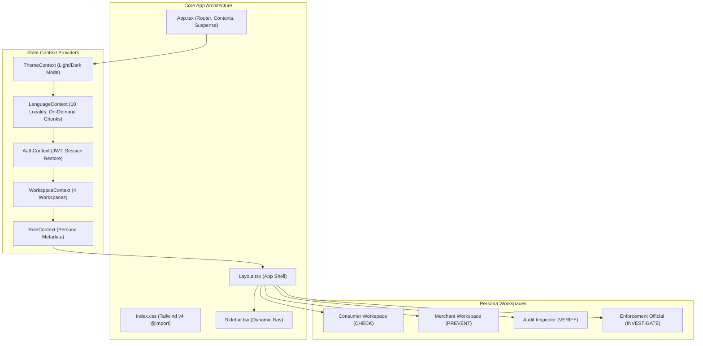
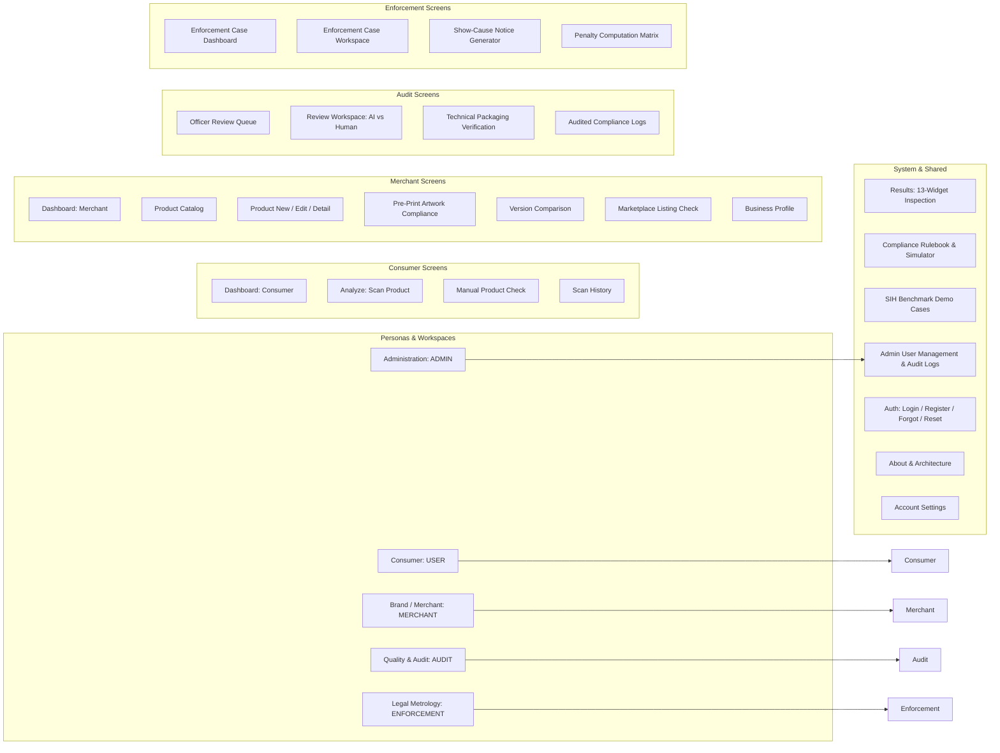
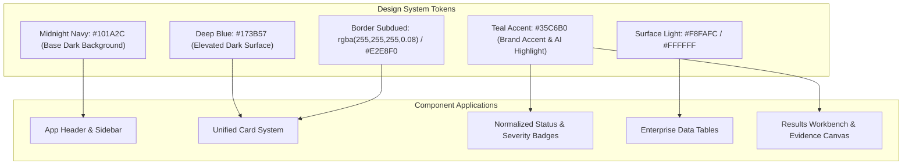
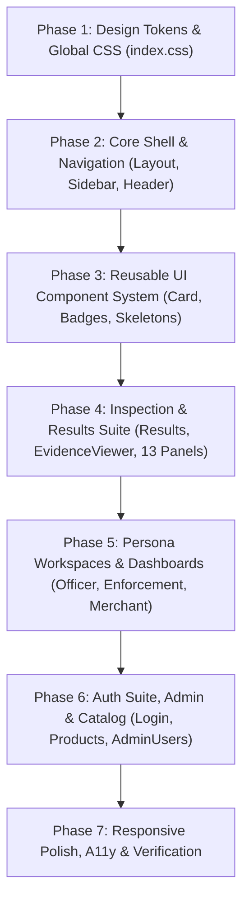

# MetrCheck AI — Frontend UI/UX Audit & Redesign Implementation Plan
**National Hackathon 6.0 | Legal Metrology & FSSAI AI Compliance Suite**  
**Document Status:** Read-Only Audit & Execution Blueprint (Phase 1)  
**Date:** October 2026 | **Author:** Antigravity AI  

---

## 1. Executive Summary

MetrCheck AI is an enterprise-grade artificial intelligence and computer vision platform built for the **National Hackathon 6.0**. It automates statutory label compliance screening of packaged commodities in India under the **Legal Metrology (Packaged Commodities) Rules, 2011** and **FSSAI Packaging & Labelling Regulations**.

### 1.1 Current State Assessment
An in-depth, read-only architectural audit of the frontend reveals a **technically comprehensive, deeply featured system** comprising **27 distinct pages**, **4 persona-driven workspaces** (Consumer, Merchant, Audit Inspector, Enforcement Official), a **10-language Indic internationalization subsystem**, and a **13-component results visualization suite** with optical calibration and interactive bounding-box evidence mapping.

| Metric | Current Value | Assessment |
| :--- | :--- | :--- |
| **Total Routed Pages** | 27 Screens | Highly comprehensive domain coverage |
| **Active Workspaces** | 4 Workspaces (`USER`, `MERCHANT`, `AUDIT`, `ENFORCEMENT`) | Deep role-based separation |
| **Supported Indic Locales** | 10 Languages (`en`, `hi`, `bn`, `mr`, `gu`, `pa`, `ta`, `te`, `kn`, `ml`) | Complete multi-lingual coverage |
| **Component Count** | 28 Reusable UI & Results Components | Modular architecture |
| **API Endpoints Mapped** | 45+ REST endpoints in `services/api.ts` | Fully integrated backend contracts |
| **Visual Consistency Score** | 6.2 / 10 | **Significant UI/UX friction and color fragmentation** |

### 1.2 The Core Design Problem
While the backend and domain logic are exceptionally strong, the current frontend exhibits **visual and structural fragmentation**:
1. **Ad-hoc Color Palettes:** A chaotic mix of hardcoded indigo, blue, amber, emerald, sky, purple, and rose utility classes across pages without a disciplined design token hierarchy.
2. **Visual Clutter & Cognitive Overload:** The `Results.tsx` and `Login.tsx` pages are monolithic (785 and 1,856 lines respectively) with excessive border outlines, competing badges, and inconsistent card padding.
3. **Template-Like Feel:** The interface lacks the sleek, modern aesthetic of a high-end enterprise AI tool (such as Linear, Vercel, or Stripe), currently resembling a standard Tailwind prototype.
4. **Dark Mode Inconsistencies:** Multiple cards and tables suffer from harsh border contrast, muted text illegibility, and uneven background elevation in dark mode.

### 1.3 Target Design Direction
To transform MetrCheck AI into a **showstopper product** for hackathon judges and enterprise stakeholders, this document establishes a refined design system centered on:
- **Midnight Navy (`#101A2C`)**: Grounding foundation for deep dark surfaces and headers.
- **Deep Slate/Blue (`#173B57`)**: Card elevations, subtle borders, and contextual surfaces.
- **Teal Accent (`#35C6B0`)**: Crisp, vibrant enterprise accent for primary actions, verified badges, and AI indicators.
- **Unified Glassmorphism & Micro-animations**: Subtle backdrop blur, cohesive border radiuses, unified font hierarchies, and zero functional regression.

---

## 2. Current Frontend Architecture & Technology Stack



### 2.1 Dependencies & Framework Specs
- **Runtime & Framework:** React 19 (`react@^19.2.8`, `react-dom@^19.2.8`)
- **Routing:** React Router v7 (`react-router-dom@^7.18.3`)
- **Styling Engine:** Tailwind CSS v4 (`tailwindcss@^4.3.3`, `@tailwindcss/vite@^4.3.3`)
- **Build Tool:** Vite 8 (`vite@^8.2.2`)
- **Iconography:** Lucide React (`lucide-react@^1.41.0`)
- **Data Visualizations:** Recharts (`recharts@^3.10.1`)
- **TypeScript:** Strict TypeScript 6.0 (`typescript@~6.0.2`)
- **Linter:** Oxlint (`oxlint@^1.79.0`)

### 2.2 Global Styling & Typography
- **Current `index.css` (85 lines):** Minimal setup with `@import 'tailwindcss'`, `@custom-variant dark`, modern scrollbars, and accessible `.skip-to-content` link.
- **Font Stack:** `'Inter', system-ui, -apple-system, BlinkMacSystemFont, 'Segoe UI', Roboto, 'Noto Sans', 'Noto Sans Devanagari', 'Noto Sans Bengali', 'Noto Sans Gujarati', 'Noto Sans Gurmukhi', 'Noto Sans Tamil', 'Noto Sans Telugu', 'Noto Sans Kannada', 'Noto Sans Malayalam', sans-serif;`
- **Issue:** No CSS custom properties or design tokens are defined in `index.css`. All components rely on direct inline Tailwind utility classes.

### 2.3 Internationalization (i18n) Engine
- **Supported Languages:** 10 Languages defined in `SUPPORTED_REPORT_LANGUAGES`:
  - `en` (English), `hi` (Hindi), `bn` (Bengali), `mr` (Marathi), `gu` (Gujarati), `pa` (Punjabi), `ta` (Tamil), `te` (Telugu), `kn` (Kannada), `ml` (Malayalam).
- **Chunk-Splitting Architecture:** English baseline (`en.json`) is bundled statically; Indic locales are loaded dynamically via `import('./locales/[lang].json')` on demand.
- **Interpolation:** `translate(lang, key, params)` handles nested keys and dynamic `{param}` placeholders.

### 2.4 State Management & Context Layer
1. **`AuthContext.tsx`:** Manages `AuthUser`, token storage (`metrcheck-token` in `localStorage`), login, registration (User & Merchant), and session restore via `/api/auth/me`.
2. **`WorkspaceContext.tsx`:** Manages 4 workspaces (`USER`, `MERCHANT`, `AUDIT`, `ENFORCEMENT`), allowed workspaces based on `BackendRole`, persistent active workspace (`metrcheck-active-workspace`), and permission helper booleans.
3. **`RoleContext.tsx`:** Maps the active workspace to `RoleInfo` (badge label, officer ID, jurisdiction, description).
4. **`LanguageContext.tsx`:** Synchronizes report and interface language with `localStorage` (`metrcheck_report_language`).
5. **`ThemeContext.tsx`:** Light and Dark theme state synchronized with `localStorage` (`metrcheck-theme`) and `document.documentElement.classList`.

---

## 3. Comprehensive Inventory of Screens & Workflows

MetrCheck AI contains **27 screens** categorized into 4 distinct persona workflows and shared system pages:



### Detailed Screen Catalog

| # | Screen Name | File Path | Workspace | Primary Purpose & Features |
| :- | :--- | :--- | :--- | :--- |
| **1** | **Dashboard** | `pages/Dashboard.tsx` | All | Role-aware landing hub; displays KPI cards, scan trends, recent scans, quick action buttons, and merchant SKU summaries. |
| **2** | **Analyze (Product Scanner)** | `pages/Analyze.tsx` | `USER`, `AUDIT`, `ENFORCEMENT` | Multi-panel photo uploader (Front, Back, Side 1, Side 2), camera capture, live progress stepper, pre-computed demo selector. |
| **3** | **Manual Product Check** | `pages/ManualProductCheck.tsx` | `USER` | Manual declaration input form for consumers without clear packaging photos; verifies against statutory mandatory rules. |
| **4** | **Analyze Listing (E-Commerce)** | `pages/AnalyzeListing.tsx` | `MERCHANT`, `AUDIT`, `ENFORCEMENT` | E-commerce marketplace text/listing compliance analyzer (structured fields vs raw listing copy). |
| **5** | **Results (Master Inspection)** | `pages/Results.tsx` | All | 13-section composite screen: Score gauge, Executive Summary, Risk breakdown, Package preview, Attention required, Action queue, Compliance table, Package snapshot, Rule 12 font height, Vision analysis, External verification (FSSAI/GS1), Evidence viewer, and Statutory Notice modal. |
| **6** | **Screening History** | `pages/History.tsx` | All | Historical scan ledger with search, filtering by compliance status, deletion, and quick navigation. |
| **7** | **Pre-Print Compliance** | `pages/PrePrintCompliance.tsx` | `MERCHANT` | PDF artwork inspection, layout zone overlays, physical font size verification, designer correction checklist, approval sign-off. |
| **8** | **Version Comparison** | `pages/VersionComparison.tsx` | `MERCHANT`, `AUDIT`, `ENFORCEMENT` | Side-by-side version diffing (MRP, quantity, FSSAI, ingredients, nutrition changes, rule regressions/fixes, timeline). |
| **9** | **Officer Dashboard** | `pages/OfficerDashboard.tsx` | `AUDIT`, `ENFORCEMENT` | Audit verification queue, SLA tracking, workload distribution across inspectors, triage filters. |
| **10** | **Review Workspace** | `pages/ReviewWorkspace.tsx` | `AUDIT`, `ENFORCEMENT` | Side-by-side AI vs. Human inspection, field correction overrides, bounding box modification, official approval / escalation. |
| **11** | **Enforcement Dashboard** | `pages/EnforcementDashboard.tsx` | `ENFORCEMENT` | Case management metrics (Open, Investigation, Penalty Review, Notices Issued, Hearings, Closed), case search & filter. |
| **12** | **Enforcement Case Workspace** | `pages/EnforcementCaseWorkspace.tsx` | `ENFORCEMENT` | Full case dossier, statutory violation clauses (Sec 36/38), fine calculation matrix, Show-Cause Notice dispatch, timeline. |
| **13** | **Product Catalog** | `pages/Products.tsx` | `MERCHANT` | Merchant product catalog, SKU management, scan count, latest compliance status, category filtering. |
| **14** | **Product New** | `pages/ProductNew.tsx` | `MERCHANT` | Form to register a new product SKU with declared packaging attributes (MRP, GTIN, FSSAI, manufacturer). |
| **15** | **Product Detail** | `pages/ProductDetail.tsx` | `MERCHANT` | SKU details, compliance history, attached artwork versions, and scan history. |
| **16** | **Product Edit** | `pages/ProductEdit.tsx` | `MERCHANT` | Modify existing product SKU declarations. |
| **17** | **Business Profile** | `pages/BusinessProfile.tsx` | `MERCHANT` | Merchant company profile, business address, GSTIN, and manufacturing licenses. |
| **18** | **Compliance Rules** | `pages/ComplianceRules.tsx` | All | Statutory rule registry (LM-001 through LM-010, FSSAI rules), search, filter by domain/category, and interactive simulation tester. |
| **19** | **Demo Cases** | `pages/DemoCases.tsx` | All | Curated benchmark packaging scenarios (Royal Gold Rice, FreshVita Juice, QuickBite Noodles, Alpino Oats, Tak-a-Tak). |
| **20** | **About & Architecture** | `pages/About.tsx` | All | Technical architecture overview, SIH problem statement, system components, and regulatory scope. |
| **21** | **Account Settings** | `pages/AccountSettings.tsx` | All | Profile overview, recovery email update, and session details. |
| **22** | **Admin Users** | `pages/AdminUsers.tsx` | `ADMIN` | User provisioning, officer access request review & approval, suspension, role assignment, security audit logs. |
| **23** | **Login & Registration** | `pages/Login.tsx` | Public | Multi-branch auth interface: Consumer Login/Register, Merchant Business Registration, Officer Access Request. |
| **24** | **Admin Login** | `pages/AdminLogin.tsx` | Public | Dedicated administrative portal login. |
| **25** | **Forgot Password** | `pages/ForgotPassword.tsx` | Public | Recovery email request with automated reset link dispatch. |
| **26** | **Reset Password** | `pages/ResetPassword.tsx` | Public | Secure password reset with token verification. |
| **27** | **Activate Account** | `pages/ActivateAccount.tsx` | Public | Officer / invited user onboarding and password creation. |

---

## 4. Prioritized UI/UX Issues & Heuristic Audit

### 4.1 Severity Classification Matrix

```
┌────────────────────────────────────────────────────────────────────────┐
│  P0: Critical Hackathon Visual & Interaction Flaws (Demo Visibility)  │
│  P1: Design System Inconsistencies & Visual Hierarchy Deficiencies    │
│  P2: Ergonomic Polish, Micro-Interactions & Minor Spacing Fixes        │
└────────────────────────────────────────────────────────────────────────┘
```

---

### 4.2 Detailed Findings by Category

#### Category A: Visual Hierarchy, Spacing & Card Consistency (P0 / P1)
1. **Inconsistent Border Radius & Padding Across Cards:**
   - `Card.tsx` uses `rounded-2xl` and `p-6` (or `p-4` when `compact`).
   - `AccountSettings.tsx` uses `rounded-3xl` with `p-6 sm:p-8`.
   - `ResultsHeader.tsx` uses `rounded-xl` and `rounded-2xl` arbitrarily.
   - `PrePrintCompliance.tsx` and `ReviewWorkspace.tsx` use inline `rounded-xl border border-slate-800`.
   - **Impact:** The application feels like multiple different developers built disjointed screens without a cohesive container system.
2. **Harsh and Heavy Borders:**
   - Excessive reliance on dark mode borders: `border-slate-800`, `border-slate-700/80`, `border-indigo-500/30`, `border-amber-500/40`.
   - Result: Visual "box-in-a-box" clutter where every section looks like a distinct boxed container rather than a flowing dashboard.
3. **Disparate Section Headers:**
   - Headings alternate randomly between `text-xs font-bold uppercase`, `text-sm font-bold`, `text-base font-bold`, and `text-lg font-extrabold` without standard typographic semantics.

#### Category B: Color Palette Discordance & Badge Fragmentation (P0)
1. **Ad-Hoc Badge Styling:**
   - `StatusBadge.tsx` uses 5 variants with custom `sizeClasses` and `iconSizes`.
   - `SeverityBadge.tsx` uses hardcoded classes: `bg-rose-500/20`, `bg-amber-500/20`, `bg-blue-500/20`.
   - `AdminUsers.tsx` defines custom `ROLE_STYLES`, `STATUS_STYLES`, and `OFFICER_REQUEST_STATUS_STYLES` with hardcoded slate/amber/indigo colors.
   - `EnforcementDashboard.tsx` defines its own `getStatusBadge` and `getSeverityBadge` with yet another set of color combinations.
   - **Impact:** A single status like "VERIFIED" or "CRITICAL" renders in 3 different shades and styles across different screens.
2. **Missing Brand Accent Identity:**
   - The app currently defaults to generic Tailwind indigo (`#4f46e5` / `#6366f1`) and emerald (`#10b981`), lacking the high-end enterprise AI aesthetic of Midnight Navy (`#101A2C`), Deep Blue (`#173B57`), and Teal (`#35C6B0`).

#### Category C: Monolithic Screens & Cognitive Load (P0)
1. **`Results.tsx` Information Density:**
   - The results page currently stacks 13 full-width components sequentially (`ExecutiveSummary`, `RiskFactorBreakdown`, `PackagePreview`, `AttentionRequired`, `ActionQueue`, `ComplianceTable`, `RequirementDrawer`, `PackageSnapshot`, `ConfidencePanel`, `Rule12Section`, `VisionAnalysisPanel`, `ExternalVerification`, `EvidenceViewer`).
   - While `StickySectionNav` helps, the user is overwhelmed by sheer scroll depth (over 5,000px on desktop).
   - **Solution:** Reorganize the screen into a **high-density, multi-column tabbed workbench** with a persistent primary summary split (Left: Evidence & Image Preview; Right: Compliance Matrix & Action Queue).
2. **`Login.tsx` Multi-Tier Complexity:**
   - 1,856 lines with 3 access categories, 2 officer subtypes, 2 auth modes, and an embedded officer access request modal.
   - The visual presentation suffers from excessive nested borders, tall form stacks, and cramped mobile layouts.

#### Category D: Interactive Evidence Viewer Ergonomics (P1)
1. **Evidence Canvas & Bounding Box Overlays (`EvidenceViewer.tsx` - 75KB):**
   - High technical fidelity (zoom, pan, bounding box mapping, word token highlights).
   - In low-contrast images or multi-panel layouts, the sidebar checklist and image canvas compete for space, causing awkward horizontal scrolling on sub-1440px displays.
   - Bounding boxes use bright primary colors that sometimes obscure underlying package text.

#### Category E: Mobile & Responsive Squeeze Points (P1 / P2)
1. **Top Header & Workspace Dropdown:**
   - In tablet portrait and mobile viewport (<768px), the top header contains Language Selector, Workspace Switcher, Demo Badge, and Theme Toggle, which can wrap awkwardly or truncate labels.
2. **Tables in Small Screens:**
   - Tables in `ComplianceTable.tsx`, `History.tsx`, and `AdminUsers.tsx` lack horizontal scroll indicators, leading to truncated columns on mobile devices.

---

## 5. Proposed Design Direction & Design Token System

To give MetrCheck AI a **signature enterprise identity**, we introduce a bespoke design token architecture.



### 5.1 Color Palette & Semantic Tokens

```css
:root {
  /* Core Brand Tokens */
  --color-brand-midnight: #101a2c;
  --color-brand-deep-blue: #173b57;
  --color-brand-teal: #35c6b0;
  --color-brand-teal-light: #5eead4;
  --color-brand-teal-dark: #14b8a6;
  --color-brand-teal-subtle: rgba(53, 198, 176, 0.12);

  /* Light Theme Surfaces */
  --surface-bg-light: #f8fafc;
  --surface-card-light: #ffffff;
  --surface-card-hover-light: #f1f5f9;
  --border-light: #e2e8f0;
  --border-focus-light: #35c6b0;
  --text-primary-light: #0f172a;
  --text-secondary-light: #475569;
  --text-muted-light: #94a3b8;

  /* Dark Theme Surfaces */
  --surface-bg-dark: #0a101d;
  --surface-card-dark: #101a2c;
  --surface-card-elevated-dark: #173b57;
  --surface-card-hover-dark: #1d4666;
  --border-dark: rgba(255, 255, 255, 0.08);
  --border-accent-dark: rgba(53, 198, 176, 0.3);
  --text-primary-dark: #f8fafc;
  --text-secondary-dark: #cbd5e1;
  --text-muted-dark: #64748b;

  /* Semantic Status Tokens */
  --status-compliant: #35c6b0;
  --status-compliant-bg: rgba(53, 198, 176, 0.12);
  --status-warning: #f59e0b;
  --status-warning-bg: rgba(245, 158, 11, 0.12);
  --status-violation: #f43f5e;
  --status-violation-bg: rgba(244, 63, 94, 0.12);
  --status-info: #0ea5e9;
  --status-info-bg: rgba(14, 165, 233, 0.12);
}
```

### 5.2 Typography Scale
- **Display 1 (Hero Title):** `32px / 2rem`, font-extrabold (`tracking-tight`)
- **Heading 1 (Page Title):** `22px / 1.375rem`, font-bold (`tracking-tight`)
- **Heading 2 (Card / Section Title):** `16px / 1rem`, font-bold
- **Heading 3 (Sub-section / Drawer):** `14px / 0.875rem`, font-semibold
- **Body Regular:** `13px / 0.8125rem`, font-normal (`leading-relaxed`)
- **Body Small / Captions:** `11px / 0.6875rem`, font-medium
- **Micro / Mono Badges:** `10px / 0.625rem`, font-mono, font-bold (`tracking-wider uppercase`)

### 5.3 Elevation & Glassmorphism Rules
- **Base Card:** `bg-white dark:bg-[#101A2C] border border-slate-200/80 dark:border-white/10 rounded-2xl shadow-xs`
- **Elevated Card (Active / Highlighted):** `bg-slate-50 dark:bg-[#173B57] border border-slate-300/80 dark:border-teal-500/30 rounded-2xl shadow-md`
- **Glass Overlay (Modals & Headers):** `backdrop-blur-md bg-white/90 dark:bg-[#101A2C]/90 border-b border-slate-200/80 dark:border-white/10`
- **Focus Rings:** `focus-visible:outline-2 focus-visible:outline-[#35C6B0] focus-visible:outline-offset-2`

---

## 6. Functional Preservation & Non-Regression Safeguards

To prevent breaking existing functionality, the redesign must strictly adhere to the following contracts:

### 6.1 Backend API & Endpoint Integrity
No API calls, headers, request bodies, or response parsing in `frontend/src/services/api.ts` may be modified:
- `/api/auth/login`, `/api/auth/register-user`, `/api/auth/register-merchant`, `/api/auth/me`, `/api/auth/forgot-password`, `/api/auth/reset-password`, `/api/auth/activate`
- `/api/admin/*` (Users, Officer Requests, Audit Logs)
- `/api/analyze` (Multipart form data with `files`, `labels`, `product_id`)
- `/api/analyze/text`, `/api/analyze/manual`, `/api/extract`, `/api/compliance/check`
- `/api/history`, `/api/history/{id}`, `/api/stats`, `/api/stats/trends`, `/api/stats/by-status`
- `/api/enforcement/*` (Penalty estimation, Show-Cause Notice, case management)
- `/api/preprint/*` (Upload artwork, analyze artwork, approve, correction upload)
- `/api/versions/*` (Compare versions, targets, timeline)
- `/api/reviews/*` (Dashboard, queue, assign, accept, reject, correct-field, evidence add/remove)
- `/api/products/*` (Catalog CRUD, stats, history, artworks)
- `/api/demo/*` (Cases, samples, sample images)
- `/api/report/{id}` (PDF, CSV, XLSX, JSON download ticket flow)

### 6.2 Workspace & Role-Based Access Rules
- The 4-workspace logic in `WorkspaceContext.tsx` (`getAllowedWorkspacesForRole`, `getDefaultWorkspaceForRole`, `canUseEnforcementFeatures`, `canDeleteAnalyses`) must remain 100% functional.
- The route guards in `App.tsx` (`RequireAuth`, `AdminOnly`, `MerchantOrAdmin`) must remain strictly intact.

### 6.3 Multilingual & i18n Fidelity
- All 10 supported languages (`en`, `hi`, `bn`, `mr`, `gu`, `pa`, `ta`, `te`, `kn`, `ml`) and locale files in `src/i18n/locales/*.json` must remain operational.
- All dynamic interpolation keys passed to `t(key, params)` must be preserved.

### 6.4 Mathematical & Coordinate Math Preservation
- Bounding box coordinates (`bbox: [x1, y1, x2, y2]`), image aspect ratio transformations, and SVG progress circle offset math in `ScoreCircle.tsx` and `EvidenceViewer.tsx` must not be broken or altered during visual refactoring.

---

## 7. Phased Implementation Plan

The redesign is broken down into **7 sequential, safe phases**. Each phase specifies target files, visual upgrades, regression risks, acceptance criteria, and reusable components.



---

### Phase 1: Shared Design Tokens & Global CSS Foundation

#### 1. Target Files
- `frontend/src/index.css`
- `frontend/src/types/index.ts` (Theme token types if applicable)

#### 2. Expected Visual Improvements
- Introduction of CSS custom properties for Midnight Navy (`#101A2C`), Deep Blue (`#173B57`), and Teal Accent (`#35C6B0`).
- Unified dark mode background gradient (`bg-gradient-to-b from-[#0A101D] via-[#101A2C] to-[#0A101D]`).
- Clean, high-performance typography styles with font feature settings (`'cv02', 'cv03', 'cv04', 'cv11'`).
- Crisp, custom-styled scrollbars with theme-aware thumb tints.
- Global accessible focus rings matching `--color-brand-teal`.

#### 3. Functional Regression Risks
- Low. CSS-only changes. No component logic or state alterations.

#### 4. Acceptance Criteria
- [ ] Custom CSS variables declared in `:root` and verified in Chrome/Firefox/Edge.
- [ ] Dark mode toggle smoothly switches surface colors without flickering.
- [ ] Text rendering remains crystal clear across all 10 Indic script fonts.

---

### Phase 2: Core Application Shell & Navigation Modernization

#### 1. Target Files
- `frontend/src/components/layout/Layout.tsx`
- `frontend/src/components/layout/Sidebar.tsx`
- `frontend/src/components/ui/LanguageSelector.tsx`
- `frontend/src/components/ui/ThemeToggle.tsx`

#### 2. Expected Visual Improvements
- **Sidebar Redesign:** Sleek Midnight Navy surface (`#101A2C`) with refined category dividers, active item glowing Teal indicators, and a clean collapsible state.
- **Top Header Bar:** Frosted glassmorphism header (`backdrop-blur-md bg-white/80 dark:bg-[#101A2C]/80`) with subtle 1px border.
- **Workspace Switcher Dropdown:** Redesigned interactive modal with role badges, clear visual indicators for authorized vs. locked workspaces, and subtle micro-animations.
- **System Health Indicator:** Elegant pulse pill with real-time API latency badge.

#### 3. Functional Regression Risks
- Breaking mobile drawer open/close behavior.
- Breaking workspace switching or role-based navigation redirects.
- Breaking language selection persistence.

#### 4. Acceptance Criteria
- [ ] Workspace switcher correctly switches between `USER`, `MERCHANT`, `AUDIT`, and `ENFORCEMENT`.
- [ ] Mobile hamburger drawer opens smoothly and closes on `Escape` or backdrop click.
- [ ] Language switcher seamlessly updates global dictionary without re-rendering errors.
- [ ] Theme toggle switches effortlessly between light and dark surfaces.

#### 5. Reusable Components
- `ThemeToggle`, `LanguageSelector`, `Sidebar`, `Layout`.

---

### Phase 3: Reusable UI Component Library Normalization

#### 1. Target Files
- `frontend/src/components/ui/Card.tsx`
- `frontend/src/components/ui/StatusBadge.tsx`
- `frontend/src/components/ui/SeverityBadge.tsx`
- `frontend/src/components/ui/ScoreCircle.tsx`
- `frontend/src/components/ui/ConfidenceBar.tsx`
- `frontend/src/components/ui/EmptyState.tsx`
- `frontend/src/components/ui/LoadingSkeleton.tsx`
- `frontend/src/components/ui/StickySectionNav.tsx`
- `frontend/src/components/ui/Drawer.tsx`
- `frontend/src/components/ui/ErrorBoundary.tsx`

#### 2. Expected Visual Improvements
- **Unified Card:** Consistent `rounded-2xl`, subtle hover lift, customizable header action slot, collapsible animation, and theme-aware borders.
- **Standardized Status Badges:** Consistent pills for `COMPLIANT`, `REVIEW_REQUIRED`, `NON_COMPLIANT`, and `NOT_APPLICABLE` utilizing the Teal/Amber/Rose palette.
- **Score Gauge Upgrade:** Polished SVG circular meter in `ScoreCircle.tsx` with vibrant gradient stroke and refined typography.
- **Confidence Bars:** Dual-tone progress meters with precision percentage tooltips.
- **Loading Skeletons:** Shimmer gradient animations (`animate-pulse` with custom gradient sweep).

#### 3. Functional Regression Risks
- Breaking click handlers in `Card.tsx` collapsible state.
- Score offset calculation errors in `ScoreCircle.tsx`.
- Status mapping omissions in `StatusBadge.tsx`.

#### 4. Acceptance Criteria
- [ ] All status strings (`COMPLIANT`, `PASS`, `FAIL`, `REVIEW_REQUIRED`, etc.) render appropriate badge styles.
- [ ] ScoreCircle accurately calculates SVG circumferences for scores 0–100.
- [ ] Skeletons display smoothly during data fetching without layout shifting.

---

### Phase 4: High-Impact Analysis & Results Redesign

#### 1. Target Files
- `frontend/src/pages/Analyze.tsx`
- `frontend/src/pages/Results.tsx`
- `frontend/src/components/EvidenceViewer.tsx`
- `frontend/src/components/results/ResultsHeader.tsx`
- `frontend/src/components/results/ExecutiveSummary.tsx`
- `frontend/src/components/results/RiskFactorBreakdown.tsx`
- `frontend/src/components/results/PackagePreview.tsx`
- `frontend/src/components/results/AttentionRequired.tsx`
- `frontend/src/components/results/ActionQueue.tsx`
- `frontend/src/components/results/ComplianceTable.tsx`
- `frontend/src/components/results/RequirementDrawer.tsx`
- `frontend/src/components/results/PackageSnapshot.tsx`
- `frontend/src/components/results/ConfidencePanel.tsx`
- `frontend/src/components/results/Rule12Section.tsx`
- `frontend/src/components/results/VisionAnalysisPanel.tsx`
- `frontend/src/components/results/ExternalVerification.tsx`

#### 2. Expected Visual Improvements
- **`Analyze.tsx`:** Sleek drag-and-drop zone with animated upload indicators, live webcam modal, slot status chips (Required / Recommended / Optional), and demo case quick-load cards.
- **`Results.tsx`:** Transformation from a long monolithic stack into an **integrated compliance workbench**:
  - **Hero Header:** Compact product banner with brand badge, extraction mode pill, language selector, and export action dropdown (PDF/CSV/XLSX/JSON).
  - **Overview Split:** High-impact gauge & executive summary alongside package photo thumbnail and risk score breakdown.
  - **Compliance Matrix:** Interactive table with filter tabs (All, Critical, Warnings, Passed), inline evidence inspection triggers, and sliding requirement drawer.
  - **Evidence Viewer (`EvidenceViewer.tsx`):** High-precision bounding box canvas with zoom/pan controls, multi-panel tabs, and word token confidence overlays.
  - **Statutory Notice Modal:** Authentic Government of India Directorate of Legal Metrology Show-Cause Notice draft with print and copy controls.

#### 3. Functional Regression Risks
- Breaking multipart file upload payload to `/api/analyze`.
- Breaking bounding box coordinate scaling on resized windows.
- Breaking PDF/CSV/XLSX export ticket download flow.
- Breaking Show-Cause Notice print formatting.

#### 4. Acceptance Criteria
- [ ] File upload and camera capture correctly submit to backend and route to `/results/{id}`.
- [ ] Bounding boxes precisely map to detected packaging declarations.
- [ ] Export buttons trigger authenticated file downloads seamlessly.
- [ ] Requirement drawer opens with complete legal citations and recommendations.

---

### Phase 5: Persona Workspaces & Dashboards Redesign

#### 1. Target Files
- `frontend/src/pages/Dashboard.tsx`
- `frontend/src/pages/OfficerDashboard.tsx`
- `frontend/src/pages/ReviewWorkspace.tsx`
- `frontend/src/pages/EnforcementDashboard.tsx`
- `frontend/src/pages/EnforcementCaseWorkspace.tsx`
- `frontend/src/pages/Products.tsx`
- `frontend/src/pages/ProductDetail.tsx`
- `frontend/src/pages/ProductNew.tsx`
- `frontend/src/pages/ProductEdit.tsx`
- `frontend/src/pages/PrePrintCompliance.tsx`
- `frontend/src/pages/VersionComparison.tsx`
- `frontend/src/pages/BusinessProfile.tsx`

#### 2. Expected Visual Improvements
- **`Dashboard.tsx`:** Adaptive layout that switches smoothly between Consumer (friendly checklist & history), Merchant (SKU metrics & pre-flight status), and Officer (audit queues & critical cases).
- **`OfficerDashboard.tsx` & `ReviewWorkspace.tsx`:** Professional audit workstation with AI vs. Human side-by-side diffing, field override forms, and audit sign-off.
- **`EnforcementDashboard.tsx` & `EnforcementCaseWorkspace.tsx`:** High-authority enforcement console with statutory penalty calculators, case timeline visualizers, and notice dispatch trackers.
- **`PrePrintCompliance.tsx`:** Multi-page PDF artwork inspector with interactive layout zones, font height check meters, and approval sign-off.
- **`VersionComparison.tsx`:** Clean side-by-side diffing with delta tags (e.g. `+10g`, `-₹5.00`), rule regression warnings, and version timeline.

#### 3. Functional Regression Risks
- Breaking officer field corrections and review status updates.
- Breaking penalty calculation formulas and repeat offender multipliers.
- Breaking artwork PDF upload and page navigation.
- Breaking version comparison selection.

#### 4. Acceptance Criteria
- [ ] Review workspace correctly submits human overrides and recalculates scores.
- [ ] Enforcement cases transition through status states (`OPEN` -> `INVESTIGATION` -> `NOTICE_ISSUED` -> `RESOLVED`).
- [ ] Pre-Print artwork zoom and layout overlay render without distortion.
- [ ] Product catalog CRUD functions seamlessly.

---

### Phase 6: Auth Suite, Administrative Controls & Secondary Screens

#### 1. Target Files
- `frontend/src/pages/Login.tsx`
- `frontend/src/pages/AdminLogin.tsx`
- `frontend/src/pages/ForgotPassword.tsx`
- `frontend/src/pages/ResetPassword.tsx`
- `frontend/src/pages/ActivateAccount.tsx`
- `frontend/src/pages/AdminUsers.tsx`
- `frontend/src/pages/ManualProductCheck.tsx`
- `frontend/src/pages/AnalyzeListing.tsx`
- `frontend/src/pages/ComplianceRules.tsx`
- `frontend/src/pages/DemoCases.tsx`
- `frontend/src/pages/History.tsx`
- `frontend/src/pages/About.tsx`
- `frontend/src/pages/AccountSettings.tsx`

#### 2. Expected Visual Improvements
- **`Login.tsx`:** Modernized split-screen authentication portal with interactive role selection cards, streamlined merchant onboarding form, and clean officer credential request dialog.
- **`AdminUsers.tsx`:** Unified administrative table with tabbed navigation (Users, Officer Requests, Audit Logs), quick approval modals, and role management.
- **`ManualProductCheck.tsx` & `AnalyzeListing.tsx`:** Refined multi-section forms with live completion meters, structured vs. raw text toggle, and clear validation highlights.
- **`ComplianceRules.tsx`:** Clean statutory rulebook with interactive rule simulator modal and JSON context override.
- **`DemoCases.tsx`:** Showcase benchmark scenario cards with expected score gauges, panel badges, and instant execution.
- **`History.tsx`:** Clean data table with date range filtering, score badges, and batch deletion modals.

#### 3. Functional Regression Risks
- Breaking user authentication, token storage, and session recovery.
- Breaking officer request approval and invitation token generation.
- Breaking rule simulation execution against `/api/compliance/test-rule`.
- Breaking password reset and account activation flows.

#### 4. Acceptance Criteria
- [ ] Login and registration work across all user roles.
- [ ] Admin can approve officer requests and view security audit logs.
- [ ] Rule simulator executes live tests and returns detailed execution traces.
- [ ] Manual product check validates declarations and redirects to results.

---

### Phase 7: Verification, Accessibility & Performance Audit

#### 1. Target Files
- Entire `frontend/src` codebase.

#### 2. Testing & Verification Scope
- **Accessibility (A11y):** Full keyboard navigation (`Tab`, `Shift+Tab`, `Enter`, `Escape`), ARIA labels on all interactive icon buttons, WCAG 2.1 AA color contrast on all text and badges.
- **Responsive Layouts:** Verification across Mobile (375px), Tablet (768px), Laptop (1280px), and Desktop (1920px).
- **Multilingual UI Integrity:** Verify that layout elements do not break or wrap awkwardly in Devanagari, Bengali, Tamil, Telugu, Malayalam, Gujarati, or Punjabi.
- **Performance:** Optimize image loading with lazy fetching, ensure zero memory leaks in blob URLs via `URL.revokeObjectURL()`, and maintain sub-second page transitions.

---

## 8. Summary Checklist for Implementation Phase

| Phase | Description | Estimated Scope | Priority |
| :--- | :--- | :--- | :--- |
| **Phase 1** | Design Tokens & Global CSS (`index.css`) | 1 file | P0 (Foundation) |
| **Phase 2** | App Shell & Navigation (`Layout`, `Sidebar`, Header) | 4 files | P0 (App Shell) |
| **Phase 3** | Reusable UI Component Library (Card, Badges, Meters) | 10 files | P0 (Shared UI) |
| **Phase 4** | Inspection & Results Suite (`Analyze`, `Results`, `EvidenceViewer`) | 16 files | P0 (Core Demo) |
| **Phase 5** | Persona Workspaces (`Officer`, `Enforcement`, `Merchant`) | 12 files | P1 (Workspaces) |
| **Phase 6** | Auth Suite, Admin & Catalog (`Login`, `AdminUsers`, `Products`) | 13 files | P1 (Workflows) |
| **Phase 7** | A11y, Indic Script Polish & Responsive Verification | Cross-cutting | P2 (Polish) |

---
*End of MetrCheck AI Frontend UI/UX Audit & Implementation Plan. Phase 1 Read-Only Audit Complete.*
